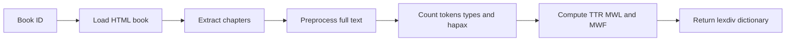
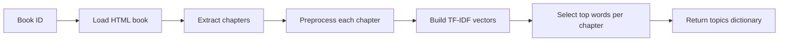

# Bookworm

Bookworm is a simple NLP tool for Project Gutenberg books.  
It can analyze one book from the command line or from a small Streamlit dashboard.

## Features

- lexical diversity
- topic extraction
- named entities recognition
- book summarization
- book similarity
- book card

## Installation

Create a virtual environment and install the dependencies:

```bash
python3 -m venv .venv
source .venv/bin/activate
pip install -r requirements.txt
python -m spacy download en_core_web_sm
```

## CLI Usage

General form:

```bash
python3 bookworm.py <BOOK_ID> [OPTION]
```

Examples:

```bash
python3 bookworm.py 11 --lexdiv
python3 bookworm.py 11 --topics
python3 bookworm.py 11 --entities
python3 bookworm.py 11 --summarize
python3 bookworm.py 11 --similar
python3 bookworm.py 11 --card
```

Available options:

- `--lexdiv`
- `--topics`
- `--entities`
- `--summarize`
- `--similar`
- `--card`

## Dashboard

Run the frontend with:

```bash
streamlit run app.py
```

The dashboard lets you:

- choose a Gutenberg book ID
- select one or more analyses
- display the result in a simple interactive view

## Project Structure

- `bookworm.py` : CLI entry point
- `app.py` : Streamlit dashboard
- `loader.py` : HTML download and cache
- `html_parser.py` : chapter and metadata extraction
- `preprocess.py` : text preprocessing
- `lexdiv.py` : lexical diversity metrics
- `topics.py` : topic extraction
- `entities.py` : named entities extraction
- `summary.py` : extractive summary
- `similarity.py` : similarity with TF-IDF and cosine similarity
- `card.py` : book card aggregation

## Mermaid Diagrams

### Lexical Diversity



### Topic Modeling



### Named Entities Recognition


### Summarization


### Similarity


### Book Card


