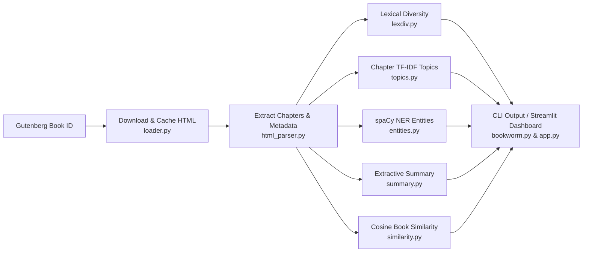

# Bookworm (Alice in Wonderland) — Project Gutenberg NLP Suite

Bookworm is a modular **Natural Language Processing (NLP)** toolkit and interactive **Streamlit** dashboard for analyzing literary works from **Project Gutenberg**. Given any Project Gutenberg book ID (such as ID `11` — *Alice's Adventures in Wonderland*), Bookworm automatically downloads, caches, parses, and analyzes the book via both a **Command-Line Interface (`bookworm.py`)** and a **Web Dashboard (`app.py`)**.

---

## Key Features

- **Automated HTML Scraping & Caching (`loader.py`, `html_parser.py`):**
  - Fetches Project Gutenberg HTML editions, caches them locally, and extracts book metadata (title, authors, bookshelves) and individual chapter segments.
- **Lexical Diversity Analysis (`lexdiv.py`):**
  - Computes total tokens (`tok`), unique word types (`typ`), hapax legomena (`hap`), Type-Token Ratio (`ttr`), Mean Word Length (`mwl`), and Mean Word Frequency (`mwf`).
- **Chapter-Level Topic Extraction (`topics.py`):**
  - Applies **TF-IDF** vectorization across chapters to extract the most salient keywords for every section of the book.
- **Named Entity Recognition (`entities.py`):**
  - Uses **spaCy** (`en_core_web_sm`) to identify, deduplicate, and separate **Characters (`PERSON`)** and **Locations (`GPE` / `LOC`)**.
- **Extractive Summarization (`summary.py`):**
  - Scores sentences by normalized word-frequency weights and extracts the top representative sentences in chronological order.
- **Cross-Corpus Book Similarity (`similarity.py`):**
  - Computes **TF-IDF cosine similarity** between the target book and a reference corpus to recommend the top 5 most similar books.
- **Unified Book Card (`card.py`):**
  - Aggregates metadata and all NLP analyses into a single structured summary card.

---

## Pipeline Architecture

### 1. Unified Book Card Pipeline



### 2. Individual Analysis Flows

- **Lexical Diversity:** `Load HTML → Extract Chapters → Preprocess Tokens → Count Tokens, Types & Hapax → Compute TTR, MWL & MWF`
- **Topic Modeling:** `Load HTML → Extract Chapters → Preprocess per Chapter → Build TF-IDF Matrix → Rank Top Terms per Chapter`
- **Named Entity Recognition:** `Load HTML → Concatenate Text → Run spaCy Pipeline → Filter & Deduplicate Characters and Locations`
- **Extractive Summarization:** `Load HTML → Tokenize Sentences via spaCy → Score Sentences by Word Frequency → Output Top Sentences`
- **Book Similarity:** `Load Target Book & Corpus → Preprocess Texts → Compute TF-IDF Vectors → Rank Top 5 by Cosine Similarity`

---

## Project Structure

```text
aliceinwonderland/
├── bookworm.py          # Command-line interface (CLI) entry point
├── app.py               # Interactive Streamlit web dashboard
├── loader.py            # Project Gutenberg HTML downloader and local cache manager
├── html_parser.py       # BeautifulSoup chapter segmentation and metadata parser
├── preprocess.py        # Text normalization, stopword removal, and tokenization
├── lexdiv.py            # Lexical diversity metrics (Tokens, Types, Hapax, TTR, MWL, MWF)
├── topics.py            # Chapter-level TF-IDF topic keyword extraction
├── entities.py          # spaCy Named Entity Recognition (Characters & Locations)
├── summary.py           # Word-frequency extractive text summarization
├── similarity.py        # TF-IDF + Cosine Similarity book recommender
├── card.py              # Full book card aggregator
├── requirements.txt     # Python dependencies
└── README.md
```

---

## Installation & Setup

```bash
git clone https://github.com/AlexandrG1209/aliceinwonderland.git
cd aliceinwonderland
python3 -m venv .venv
source .venv/bin/activate
pip install -r requirements.txt
python -m spacy download en_core_web_sm
```

---

## Usage

### 1. Interactive Streamlit Dashboard

```bash
streamlit run app.py
```

The dashboard allows you to enter any Project Gutenberg book ID (default `11` for *Alice's Adventures in Wonderland*), select which NLP tasks to run, and inspect metrics, expandable chapter topics, character/location lists, summaries, and similar books.

### 2. Command-Line Interface (CLI)

```bash
python3 bookworm.py <BOOK_ID> [OPTION]
```

**Examples (Book ID `11` — *Alice's Adventures in Wonderland*):**

```bash
python3 bookworm.py 11 --lexdiv       # Lexical diversity metrics
python3 bookworm.py 11 --topics       # Top keywords per chapter
python3 bookworm.py 11 --entities     # Characters and locations (NER)
python3 bookworm.py 11 --summarize    # Extractive summary
python3 bookworm.py 11 --similar      # Top 5 most similar books
python3 bookworm.py 11 --card         # Complete aggregated book card
```

---

## Tech Stack

- **Language:** Python 3
- **NLP & ML:** `spaCy`, `NLTK`, `scikit-learn`
- **Web Scraping:** `requests`, `BeautifulSoup4`
- **Frontend Dashboard:** `Streamlit`

---

## Contributors

- **Alexandr Gorlachev** — [@AlexandrG1209](https://github.com/AlexandrG1209)
- **Wystan Marshall-Solot** — [@Grizzlycraft](https://github.com/Grizzlycraft)
